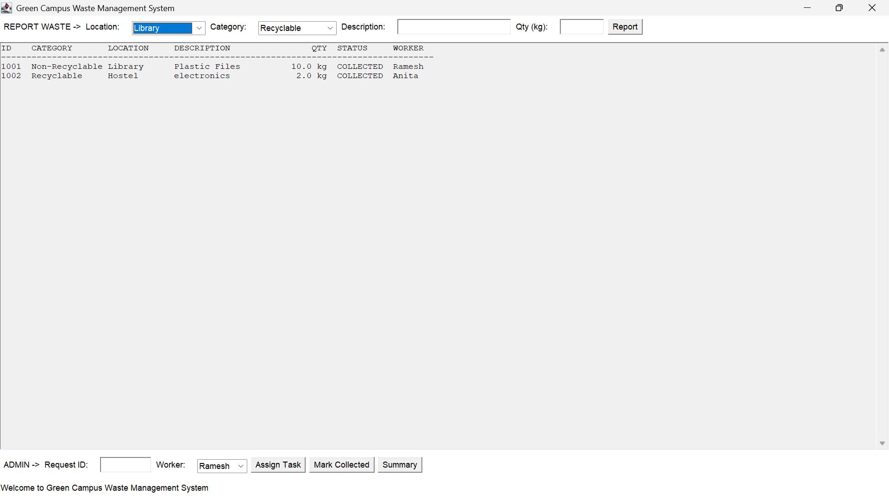
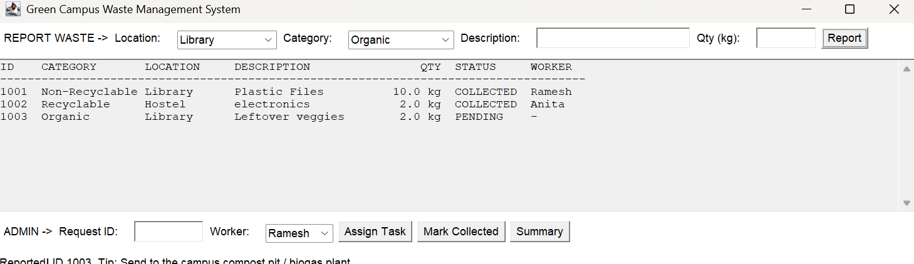
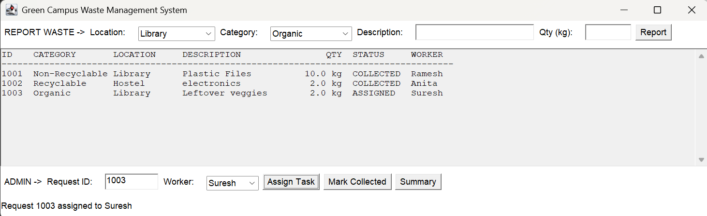
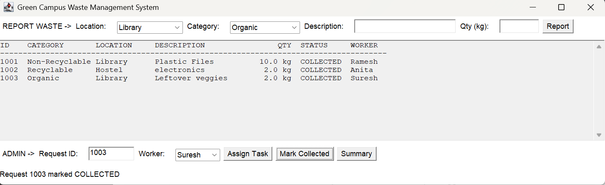

# Green Campus Waste Management System

A simple Java mini project to manage waste collection on a college campus. Users report waste from different locations and categorize it as **Recyclable**, **Non-Recyclable** or **Organic**. The administrator assigns collection tasks to workers, and every request is tracked from **PENDING** to **ASSIGNED** to **COLLECTED**.

## Features
- Report waste with location, category, description and quantity (kg)
- Disposal tip shown for each waste category
- Admin can assign a request to a worker and mark it collected
- Category-wise summary of total waste (kg)
- Data is saved to a text file and reloaded on the next start
- Input validation (empty fields, invalid numbers, unknown IDs, wrong status order)

## Java Concepts Used
| Concept | Where |
|---|---|
| Abstraction | `Waste` (abstract class) |
| Inheritance | `RecyclableWaste`, `NonRecyclableWaste`, `OrganicWaste` extend `Waste` |
| Interface | `Collectable`, implemented by `Waste` |
| Polymorphism | Category, tip and `toString()` depend on the actual waste type |
| Collections | `ArrayList` for requests and workers, `HashMap` for category totals |
| File Handling | `FileWriter`, `PrintWriter`, `BufferedReader` (`waste_data.txt`) |
| Applet life cycle | `init()`, `start()`, `stop()`, `destroy()` in `GreenCampusApplet` |

## Project Structure
```
src/            Java source files
docs/           Mini project report (PDF and DOCX)
screenshots/    Output screenshots
```

## How to Run

**Requirements:** JDK 9 to 25 (JDK 17 or 21 recommended). The Applet API was removed in JDK 26, so newer versions will not compile this project.

**Using Eclipse**
1. File > New > Java Project, then copy the files from `src/` into the project's `src` folder.
2. Right-click `GreenCampusApplet.java` > **Run As > Java Application** (not "Java Applet").

**Using the command line**
```
cd src
javac GreenCampusApplet.java
java GreenCampusApplet
```
Deprecation warnings about `Applet` are expected and harmless. A `waste_data.txt` file is created in the folder where you run the program.

## How to Use
1. **Report:** choose a location and category, enter a description and quantity, then click **Report**.
2. **Assign:** enter the request ID, choose a worker and click **Assign Task**.
3. **Collect:** enter the same ID and click **Mark Collected**.
4. **Summary:** click **Summary** to see total kg per category.

## Screenshots
| Main window | Waste reported |
|---|---|
|  |  |

| Task assigned | Marked collected |
|---|---|
|  |  |

## Report
The full mini project report is in the [`docs`](docs) folder.

## Authors
- Ritesh Buchade (RBT25CB049)
- Girish Chinchpure (RBT25CB050)
