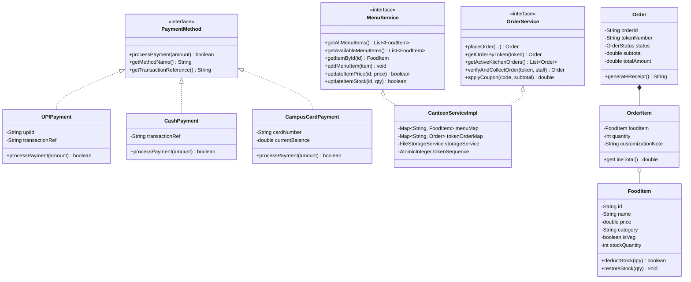

# Smart Canteen Pre-Order & Token System (Core Java Mini-Project)
### Department of Computer Science and Business Systems
### Rajarshi Shahu College of Engineering, Pune (RSCOE)
**Academic Year:** 2026-27 | **Semester:** III | **Class:** S.Y. B.Tech  
**Student Contributors:** Yashraj Ghate (RBT25CB042), Piyush Lokhande (RBT25CB043), Arush Yambarwar (RBT25CB041)

---

## 1. Overview & Objective
This Core Java mini-project demonstrates Object-Oriented Programming (OOP) principles through a complete college canteen pre-order, token generation, billing, and order lifecycle management system.

The application allows students to browse menu items, select quantities with custom instructions, apply promo discount coupons, choose payment methods, and receive a uniquely generated pickup token (`SC-XXXX`). Canteen staff can track the active kitchen queue, update cooking status, and perform a strict 5-step counter pickup verification before marking the order as collected.

---

## 2. Object-Oriented Programming (OOP) Concepts Demonstrated

| OOP Principle | Java Implementation in Project | Description |
| :--- | :--- | :--- |
| **Classes & Objects** | `FoodItem`, `OrderItem`, `Order`, `OrderStatus` | Models real-world canteen entities with dedicated state and behavior. |
| **Encapsulation** | Private instance variables with public getters, setters, and defensive copies (`Collections.unmodifiableList`). | Enforces strict validation: prevents negative prices, zero quantities, and invalid states. |
| **Inheritance & Hierarchy** | `PaymentMethod` hierarchy | `UPIPayment`, `CashPayment`, and `CampusCardPayment` implement payment contracts. |
| **Polymorphism** | Dynamic method dispatch via `PaymentMethod.processPayment()` | Runtime execution selects specific payment authorization behavior and receipt references. |
| **Abstraction & Interfaces** | `MenuService`, `OrderService`, `PaymentMethod` | Separates interface contracts from implementation details in `CanteenServiceImpl`. |
| **Custom Exceptions** | `InvalidOrderException`, `OutOfStockException`, `TokenVerificationException` | Robust error handling that safely reports user errors without program crashes. |
| **Java Collections** | `ArrayList`, `Map` (`LinkedHashMap`, `ConcurrentHashMap`), `AtomicInteger` | Manages menu catalogs, token lookup maps, and thread-safe token sequence numbering. |
| **File Persistence** | `FileStorageService` | Reads and writes canteen catalog and order records to persistent text files (`menu.txt`, `orders.txt`). |

---

## 3. Class Architecture & Mapping to Web Architecture



---

## 4. How to Run the Java Mini-Project

### Option A: From Terminal / PowerShell
```powershell
# Navigate to the java project directory
cd "C:\Users\ADMIN\.gemini\antigravity\scratch\smart-canteen-pro\java-mini-project"

# Compile all source files
javac -encoding UTF-8 -d bin (Get-ChildItem -Recurse -Filter "*.java" src | Select-Object -ExpandProperty FullName)

# Run interactive console application
java -cp bin com.rscoe.smartcanteen.Main

# Run automated verification test suite
java -cp bin -ea com.rscoe.smartcanteen.test.SmartCanteenTest
```

### Option B: In Eclipse IDE
1. Open **Eclipse IDE**.
2. Click **File -> Open Projects from File System...**
3. Select `C:\Users\ADMIN\eclipse-workspace\SmartCanteenMiniProject`.
4. Right-click `Main.java` -> **Run As -> Java Application**.

---

## 5. Verification Test Results
All 6 automated Core Java tests passed:
- `Test 1:` Default menu loaded with 15 items across categories.
- `Test 2:` Order placed with coupon `WELCOME20`, creating token `SC-1001`.
- `Test 3:` Rejected premature token verification (Order in `PLACED` status).
- `Test 4:` Lifecycle updated to `READY` -> token verified and collected successfully.
- `Test 5:` Re-use of collected token correctly rejected with security exception.
- `Test 6:` Out-of-stock validation rejected excessive item quantities.
